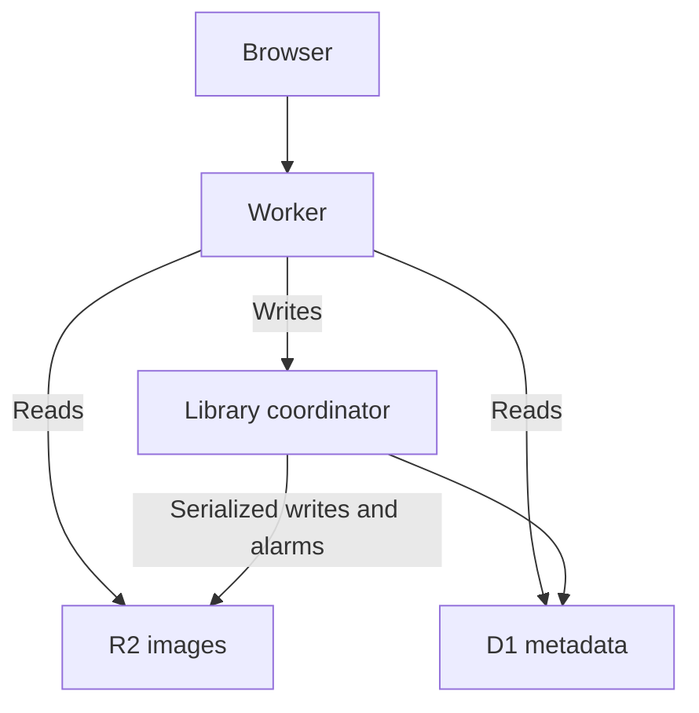

<h1 align="center">PicNest</h1>

<p align="center">
  Self-hosted image host on Cloudflare Workers + R2 + D1.<br>
  Your images, your domain, your storage — no third-party account, no ads, no link expiry.
</p>

<p align="center">
  <a href="LICENSE"></a>
  <a href="https://github.com/boltguo/PicNest/stargazers"></a>
  <a href="https://workers.cloudflare.com"></a>
</p>

<p align="center">English | <a href="README.zh-CN.md">简体中文</a></p>

## Features

- **Upload** — drag and drop, paste from the clipboard, per-file and total progress, cancellation, batch retry
- **Organize** — folders, breadcrumbs, move and rename, six sort orders
- **Browse** — thumbnails, paginated server-side sorting, lightbox preview, file details
- **Direct links** — `/f/<key>`, copy as URL, Markdown or HTML
- **Share links** — optional expiry and password, visit counts, revocable
- **Deduplication** — identical images are stored once no matter how often you upload them
- **One password** — JWT session for 7 days, login throttled at the edge
- **Bilingual** — English and Chinese, public share pages included

JPEG, PNG, GIF, WebP and AVIF, up to 32 MB per file. The format is decided by
reading the file's own bytes, not by trusting what the browser said it was.

## Self-deployment

Install Node.js, pnpm and OpenSSL, and enable R2 in your Cloudflare account.

### 1. Create the resources

```bash
git clone https://github.com/boltguo/PicNest.git
cd PicNest
pnpm install
pnpm exec wrangler login
pnpm exec wrangler r2 bucket create picnest
pnpm exec wrangler d1 create picnest
```

In `wrangler.jsonc`, replace `d1_databases[0].database_id` with the ID returned
by the last command. The R2 bucket uses the `BUCKET` binding and D1 uses `DB`;
the commands above match the resource names in the configuration.

### 2. Set the environment variables

Both variables are required and should be stored as Worker secrets in production:

| Variable | Purpose | Value |
| --- | --- | --- |
| `ADMIN_PASSWORD` | Dashboard login password | A strong password of your choice |
| `JWT_SECRET` | Signs sessions and share unlock cookies | A random key generated with `openssl rand -base64 32` |

```bash
pnpm secret
```

This prompts for `ADMIN_PASSWORD` and generates and uploads `JWT_SECRET`.
To set either value separately, use `pnpm exec wrangler secret put ADMIN_PASSWORD`
or `pnpm exec wrangler secret put JWT_SECRET`.

For local development, copy `.dev.vars.example` to `.dev.vars` and fill in the
same two variables. Keep the values out of source control.

### 3. Deploy

```bash
pnpm deploy
```

This builds the frontend, applies the remote D1 migrations and deploys the Worker.
Open the URL printed by Wrangler. You can attach a custom domain to the Worker
in the Cloudflare dashboard.

Keep the R2 bucket private: disable public access through `r2.dev` and do not
attach a custom domain to the bucket.

For an existing deployment, run `pnpm deploy` to upgrade. The migration preserves files
and share links and creates the `LIBRARY` Durable Object binding for coordinated writes
and background tasks. The two required environment variables remain the same.

On Cloudflare Workers Builds, `pnpm build` applies pending D1 migrations after the frontend
build succeeds, before the deployment command runs. Local and GitHub CI builds never
modify the remote database.

## Local development

```bash
pnpm install
cp .dev.vars.example .dev.vars   # set ADMIN_PASSWORD and JWT_SECRET
pnpm dev                         # worker :8787 + vite :5173
```

Open http://localhost:5173. Vite proxies `/api`, `/f/…`, `/t/…` and `/s/…` to the
Worker; local D1 and R2 data live in `.wrangler/state/`.

```bash
pnpm typecheck                   # worker + web
pnpm test                        # local D1/R2 integration tests and unit tests
pnpm db:generate                 # after editing worker/src/db/schema.ts
pnpm db:migrate:local            # apply the new migration locally
```

## How it works



The Worker serves reads; the `LIBRARY` Durable Object serializes writes and uses alarms
for bounded deletion and scan jobs.

One Worker serves everything: the React app as static assets, the JSON API, the
image bytes, and the server-rendered share pages.

Objects are keyed by the SHA-256 of their contents, which is what makes
deduplication free — upload the same photo into three folders and you get three
rows pointing at one object.

### Backups

**R2 is the source of truth for bytes. D1 is the source of truth for
everything else** — names, folders, which logical files exist, and every share
link. A full backup is both halves; neither reconstructs the other.

### Library maintenance

Open **Library maintenance** from the top-right menu:

- **Scan library** checks D1 and R2 in background pages, with saved progress and retry.
  Missing originals are marked without removing file records or share links. Re-upload
  the original image to restore its bytes.
- **Import** adds an unindexed object only when selected. Intentionally deleted objects
  are excluded from repair imports.
- **Generate missing thumbnails** processes existing images sequentially in your browser.
  Keep the page open; you can cancel and run it again. Originals stay unchanged, animated
  images use static thumbnails, and the lightbox loads the original. Failed previews can
  be retried by running generation again.

Folder deletion is a background task with visible progress. Uploads, moves and renames
inside its subtree are blocked until it completes. Failed tasks can resume; object cleanup
automatically retries. A shared image is removed only after its last reference is deleted.

A scan is not a full backup. Restoring names, folders and share links still requires a D1 backup.

### Security

- Login is limited to 5 attempts per minute per IP, at the edge; entering a
  share password is limited to 10 per minute per IP and link.
- The session is an HS256 JWT signed with `JWT_SECRET`, which is random and
  separate from the admin password. Rotate it to sign every session out.
- Share passwords travel in a POST body, are stored as salted PBKDF2-SHA256,
  and buy a 15-minute signed `HttpOnly` cookie scoped to that one link.
  Nothing derived from the password ever appears in a URL.
- Uploads are accepted on their file signature, not their `Content-Type`.
  SVG is not an accepted format.
- Stored bytes are served with `Content-Security-Policy: sandbox` and
  `nosniff`; the dashboard and the share pages each ship a strict CSP.

`/f/<key>` is a **permanent public link**, by design. The key is the hash of
the image, so anyone who already has the same file can compute it — access
control lives on `/s/<token>`, never on `/f/`. The response asks browsers and
proxies to cache it for a year, which nothing can recall after a delete.

PicNest stores and serves your original bytes and does not strip EXIF. Photos
straight off a phone can carry camera and location metadata.

## API

Authenticated endpoints take `Authorization: Bearer <jwt>`.

| Method | Path | Description | Auth |
| --- | --- | --- | --- |
| POST | `/api/login` | `{password}` → `{token}` | - |
| GET | `/api/list?folder=` | Paginated files; `folder`, `sort`, `limit`, `cursor` | ✓ |
| PUT | `/api/upload?name=&folder=` | Raw bytes as body; dedups by content | ✓ |
| PATCH | `/api/file` | `{id, folder?, name?}` — move / rename | ✓ |
| DELETE | `/api/file?id=` | Delete one file | ✓ |
| GET | `/api/folders` | Every folder path | ✓ |
| POST | `/api/folder` | `{path}` — create (idempotent) | ✓ |
| DELETE | `/api/folder?path=` | Start recursive deletion job (202) | ✓ |
| POST | `/api/share` | `{id, hours?, password?}` → `{url, exp}` | ✓ |
| GET | `/api/shares` | Live shares with visit counts | ✓ |
| DELETE | `/api/share?token=` | Revoke a share | ✓ |
| POST | `/api/repair` | Start consistency scan (202) | ✓ |
| GET | `/api/stats` | Global file count and deduplicated storage size | ✓ |
| GET | `/api/jobs` | Background jobs and pending cleanup count | ✓ |
| POST | `/api/jobs/:id/retry` | Resume a failed job | ✓ |
| GET | `/api/repair/:id?after=` | Paginated scan findings | ✓ |
| POST | `/api/repair/import` | `{id}` — import a selected finding | ✓ |
| PUT | `/api/thumbnail?id=&width=&height=` | WebP thumbnail, up to 512 KB | ✓ |
| GET | `/api/thumbnails/pending?after=` | Files without thumbnails | ✓ |
| GET | `/t/<key>` | Thumbnail, falling back to the original | - |
| GET | `/f/<key>` | Public direct link | - |
| GET | `/s/<token>` | Share access, or the password form | - |
| POST | `/s/<token>` | `password=` → unlock cookie, then redirect | - |

## Cost

Egress is free; operations are not. One image view that misses cache costs
1 Worker request + 1 R2 Class B operation.

| Item | Free tier |
| --- | --- |
| Storage | 10 GB |
| Class A (put / delete / list) | 1M / month |
| Class B (get / head) | 10M / month |
| Egress | Unlimited |
| Worker requests | 100k / day |

## Stack

| Layer | Choice |
| --- | --- |
| Runtime | Cloudflare Workers · R2 · D1 |
| Backend | [Hono](https://hono.dev) · [Drizzle ORM](https://orm.drizzle.team) · hono/jwt · zod · nanoid |
| Frontend | React 19 · React Router 7 · TypeScript · Vite |
| UI | [HeroUI v3](https://heroui.com) · Tailwind CSS 4 · lucide-react |
| Data layer | TanStack Query · axios · zustand |
| i18n | i18next + react-i18next |

## License

[Apache-2.0](LICENSE)
