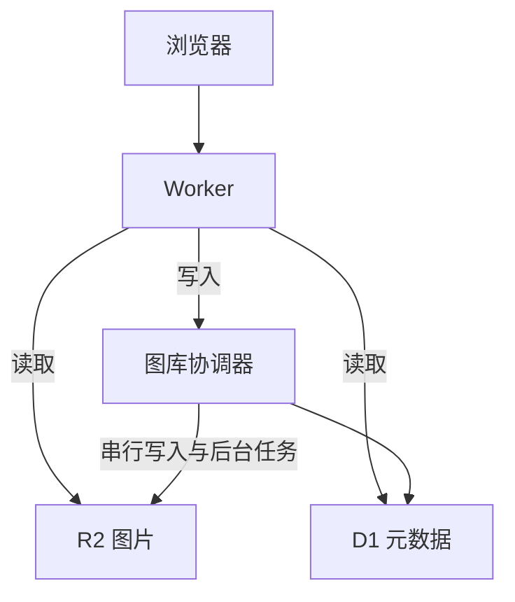

<h1 align="center">PicNest</h1>

<p align="center">
  自建图床，跑在 Cloudflare Workers + R2 + D1 上。<br>
  图片是你的，域名是你的，存储也是你的 —— 不用注册第三方账号，没有广告，链接不会过期。
</p>

<p align="center">
  <a href="LICENSE"></a>
  <a href="https://github.com/boltguo/PicNest/stargazers"></a>
  <a href="https://workers.cloudflare.com"></a>
</p>

<p align="center"><a href="README.md">English</a> | 简体中文</p>

## 功能

- **上传** —— 拖拽、剪贴板粘贴、多文件并发、单文件与总进度、取消、失败项批量重试
- **整理** —— 文件夹、面包屑导航、移动与重命名、六种排序
- **浏览** —— 缩略图网格、分页与服务端排序、灯箱预览、查看详情
- **直链** —— `/f/<key>`，支持复制 URL、Markdown 和 HTML
- **分享链接** —— 可设过期时间与访问密码，可查访问量、可撤销
- **自动去重** —— 内容相同的图片只存一份，上传多少次都一样
- **一个密码** —— JWT 会话 7 天，登录在边缘限流
- **中英双语** —— 包括对外的分享页

支持 JPEG、PNG、GIF、WebP、AVIF，单文件最大 32 MB。格式由文件自身的字节判定，不采信
浏览器声明的 `Content-Type`。

## 自行部署

准备 Node.js、pnpm 和 OpenSSL，并在 Cloudflare 账号中启用 R2。

### 1. 创建资源

```bash
git clone https://github.com/boltguo/PicNest.git
cd PicNest
pnpm install
pnpm exec wrangler login
pnpm exec wrangler r2 bucket create picnest
pnpm exec wrangler d1 create picnest
```

将 `wrangler.jsonc` 中的 `d1_databases[0].database_id` 替换为最后一条命令返回的
数据库 ID。R2 桶使用 `BUCKET` 绑定，D1 使用 `DB` 绑定；以上命令的资源名称与配置文件一致。

### 2. 设置环境变量

以下两个变量均为必填，生产环境使用 Worker Secrets 保存：

| 变量 | 用途 | 设置方式 |
| --- | --- | --- |
| `ADMIN_PASSWORD` | 后台登录密码 | 自行设置强密码 |
| `JWT_SECRET` | 签名登录会话和分享解锁 Cookie | 使用 `openssl rand -base64 32` 生成随机密钥 |

```bash
pnpm secret
```

命令会询问 `ADMIN_PASSWORD`，并自动生成、上传 `JWT_SECRET`。
单独设置时，可分别执行 `pnpm exec wrangler secret put ADMIN_PASSWORD`
和 `pnpm exec wrangler secret put JWT_SECRET`。

本地开发时，将 `.dev.vars.example` 复制为 `.dev.vars`，填写同样的两个变量。
实际值不要提交到仓库。

### 3. 发布

```bash
pnpm deploy
```

该命令会构建前端、执行远程 D1 数据库迁移并发布 Worker。
完成后打开 Wrangler 输出的网址，也可以在 Cloudflare 面板中为 Worker 绑定自定义域名。

R2 桶保持私有：关闭 `r2.dev` 公开访问，不给桶绑定自定义域名。

已有部署升级时，继续运行 `pnpm deploy`。迁移会保留现有文件和分享记录，并创建
`LIBRARY` Durable Object 绑定来协调写入和后台任务；必填环境变量仍然只有上述两个。

通过 Cloudflare Workers Builds 自动部署时，`pnpm build` 会在构建成功后自动执行 D1 迁移，
然后由现有部署命令发布 Worker；本地与 GitHub CI 构建不会修改远程数据库。

## 本地开发

```bash
pnpm install
cp .dev.vars.example .dev.vars   # 设置 ADMIN_PASSWORD 和 JWT_SECRET
pnpm dev                         # worker :8787 + vite :5173
```

打开 http://localhost:5173。Vite 把 `/api`、`/f/…`、`/t/…`、`/s/…` 代理到 Worker；
本地 D1 与 R2 数据在 `.wrangler/state/`。

```bash
pnpm typecheck                   # worker + web
pnpm test                        # 本地 D1/R2 集成测试与单元测试
pnpm db:generate                 # 改完 worker/src/db/schema.ts 之后
pnpm db:migrate:local            # 把新迁移应用到本地
```

## 工作原理



Worker 提供管理页面和读取接口，`LIBRARY` Durable Object 串行处理写入，并通过 alarm 分批完成删除与扫描。

一个 Worker 扛下全部：React 应用作为静态资源、JSON API、图片字节，以及服务端渲染的
分享页。

对象以内容的 SHA-256 为 key，去重因此是免费的 —— 同一张照片传进三个文件夹，得到的是
三条记录指向同一个对象。

### 备份

**R2 是图片字节的事实来源，D1 是其余一切的事实来源** —— 名称、文件夹、有哪些逻辑文件，
以及全部分享链接。完整备份是两边加起来，任何一边都推不出另一边。

### 图库维护

右上角菜单打开“图库维护”：

- **扫描图库**：后台分页检查 D1 和 R2，保存进度，失败后可重试。缺失原图的记录只标记异常，
  保留文件名称、文件夹和分享链接；重新上传原图即可恢复。
- **导入**：扫描结果中的未入库图片需要手动选择导入，曾主动删除的对象不会被重新导入。
- **补生成缩略图**：在浏览器中依次处理历史图片，支持取消；处理期间保持页面打开。
  原图保持不变，动图使用静态缩略图，预览仍加载原图。解码失败时可再次运行补生成。

文件夹删除会创建后台任务，进度在“图库维护”中查看。处理中或失败待重试的目录暂时禁止
上传、移动和重命名。图片清理失败时自动重试，任务完成后才移除目录。
同一张图被多个文件夹引用时，仅在最后一个引用移除后清理图片。

修复扫描不是完整备份。文件名、文件夹和分享链接的恢复仍需要 D1 备份。

### 安全

- 登录限流：每 IP 每分钟 5 次，在边缘拦；输入分享密码限流：每 IP 每条链接每分钟 10 次。
- 会话是用 `JWT_SECRET` 签名的 HS256 JWT，这个密钥是随机的，和管理密码分开。
  轮换它就等于把所有会话踢下线。
- 分享密码走 POST body 传输，存的是加盐的 PBKDF2-SHA256，验证通过后换到一个 15 分钟的
  签名 `HttpOnly` Cookie，且只对那一条链接有效。URL 里不会出现任何由密码推导出来的东西。
- 上传按文件签名判定格式，不看 `Content-Type`。SVG 不在支持的格式里。
- 存储的字节带 `Content-Security-Policy: sandbox` 和 `nosniff` 返回；管理页和分享页
  各自还有一套严格的 CSP。

`/f/<key>` 按设计就是**永久公开链接**。key 是图片的哈希，手上有同一张图的人自己就能算出
来 —— 访问控制在 `/s/<token>` 上，不在 `/f/` 上。这个响应会让浏览器和中间缓存留一年，
删除之后已经缓存的副本收不回来。

PicNest 原样存储、原样返回你的字节，不会清除 EXIF。手机直出的照片可能带着设备型号和
拍摄位置。

## API

需要鉴权的接口带 `Authorization: Bearer <jwt>`。

| 方法 | 路径 | 说明 | 鉴权 |
| --- | --- | --- | --- |
| POST | `/api/login` | `{password}` → `{token}` | - |
| GET | `/api/list?folder=` | 分页文件列表；参数 `folder`、`sort`、`limit`、`cursor` | ✓ |
| PUT | `/api/upload?name=&folder=` | body 为原始字节，按内容去重 | ✓ |
| PATCH | `/api/file` | `{id, folder?, name?}` —— 移动 / 重命名 | ✓ |
| DELETE | `/api/file?id=` | 删除单个文件 | ✓ |
| GET | `/api/folders` | 所有文件夹路径 | ✓ |
| POST | `/api/folder` | `{path}` —— 创建（幂等） | ✓ |
| DELETE | `/api/folder?path=` | 创建递归删除任务（202） | ✓ |
| POST | `/api/share` | `{id, hours?, password?}` → `{url, exp}` | ✓ |
| GET | `/api/shares` | 有效的分享列表与访问量 | ✓ |
| DELETE | `/api/share?token=` | 撤销分享 | ✓ |
| POST | `/api/repair` | 创建索引扫描任务（202） | ✓ |
| GET | `/api/stats` | 全局文件数与去重存储大小 | ✓ |
| GET | `/api/jobs` | 后台任务与待清理对象数 | ✓ |
| POST | `/api/jobs/:id/retry` | 继续失败任务 | ✓ |
| GET | `/api/repair/:id?after=` | 分页扫描结果 | ✓ |
| POST | `/api/repair/import` | `{id}`，导入选中的扫描结果 | ✓ |
| PUT | `/api/thumbnail?id=&width=&height=` | 上传 WebP 缩略图（最大 512 KB） | ✓ |
| GET | `/api/thumbnails/pending?after=` | 待生成缩略图的文件 | ✓ |
| GET | `/t/<key>` | 缩略图，未生成时回退到原图 | - |
| GET | `/f/<key>` | 公开直链 | - |
| GET | `/s/<token>` | 访问分享，或密码表单 | - |
| POST | `/s/<token>` | `password=` → 解锁 Cookie，然后重定向 | - |

## 费用

出网流量免费，操作次数不免费。一次未命中缓存的图片浏览 = 1 次 Worker 请求 + 1 次
R2 Class B 操作。

| 项目 | 免费额度 |
| --- | --- |
| 存储 | 10 GB |
| Class A（put / delete / list） | 100 万 / 月 |
| Class B（get / head） | 1000 万 / 月 |
| 出网流量 | 无限 |
| Worker 请求 | 10 万 / 天 |

## 技术栈

| 层 | 选型 |
| --- | --- |
| 运行时 | Cloudflare Workers · R2 · D1 |
| 后端 | [Hono](https://hono.dev) · [Drizzle ORM](https://orm.drizzle.team) · hono/jwt · zod · nanoid |
| 前端 | React 19 · React Router 7 · TypeScript · Vite |
| UI | [HeroUI v3](https://heroui.com) · Tailwind CSS 4 · lucide-react |
| 数据层 | TanStack Query · axios · zustand |
| 国际化 | i18next + react-i18next |

## 许可

[Apache-2.0](LICENSE)
